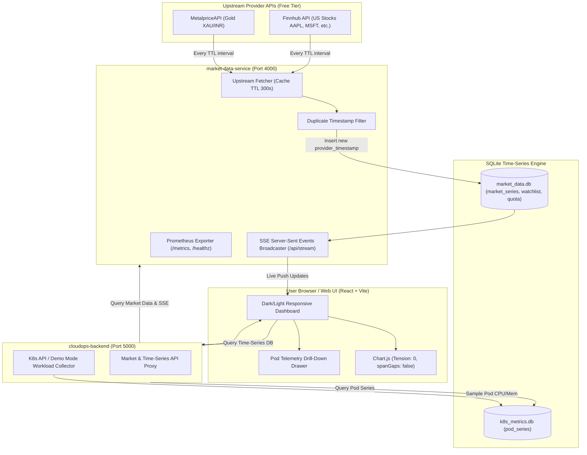

# CloudOps Market Monitor ⚡ (Interactive & Accurate Edition)

**CloudOps Market Monitor** is a smart Kubernetes infrastructure monitoring platform and financial data microservice. It provides real-time cluster workloads telemetry, persistent SQLite time-series market tracking (Gold & Stocks), microservice Prometheus health checks, and interactive charting.

---

## 🏗️ Architecture & Data Flow Diagram



---

## ⚡ Data Flow Guarantee (Accuracy First)

1. **Provider Timestamping:** Data points use the provider's exact timestamp (`provider_timestamp`) as the x-axis value.
2. **Duplicate Skipping:** Duplicate rows with the same `provider_timestamp` are skipped at the database level (`UNIQUE(symbol, provider_timestamp)`).
3. **No Synthetic / Fake Data:** Curves are rendered with zero smoothing (`tension: 0`) and zero gap interpolation (`spanGaps: false`). Outages and missing data points appear as visible gaps.
4. **SQLite Persistence:** Every successful fetch is stored in `market_data.db`. Charts query the database directly, preserving full history across browser refreshes and server restarts.
5. **SSE Live Push Updates:** The backend broadcasts newly stored rows to the browser via Server-Sent Events (`/api/stream`). Browser interactions and chart refreshes **never** trigger extra upstream API calls.

---

## 📊 Interactive Features

- **Timezone Toggle:** Switch x-axis timestamps between **IST (Asia/Kolkata)** and **UTC**.
- **Gold Unit & Exchange Rate Toggle:** Switch between **USD / troy oz** and **INR / gram** using the exact exchange rate stored with each point.
- **Stock Watchlist & Compare Mode:** Add/remove stock symbols dynamically (saved in SQLite DB). Toggle Compare Mode to view percentage change (`%`) relative to the start of the range.
- **Pod Drill-down Drawer:** Click any Pod, Node, or Alert to open a side drawer with CPU/Memory time-series charts (from SQLite), warning events, and log tails.
- **Range Selection & Availability:** Range buttons (1H, 1D, 1W, 1M). Ranges with insufficient history are disabled with an informative tooltip explaining why.
- **Export Data & Images:** Export visible chart series as CSV files or PNG images.
- **Theme Toggle & Auto-Refresh Control:** Switch between Dark/Light themes, or pause/resume live auto-refresh.

---

## 🔑 Free-Tier Limitations & Quota Safety

1. **MetalpriceAPI:** ~100 requests/month free tier limit. The service caches responses for 300 seconds (`GOLD_CACHE_TTL`), using local SQLite history when quota is exhausted (`is_stale: true`).
2. **Finnhub Stock API:** 60 API calls/minute free limit. Responses are cached and backed by persistent SQLite storage.
3. **Demo Mode:** When no API keys are supplied or no K8s cluster is connected, demo data is served and clearly labeled with a **DEMO DATA** watermark tag on all charts.

---

## ⚡ Quick Start Options

### Option A: Local Development (`npm`)

```bash
# 1. Start Market Service
cd market-data-service
npm start

# 2. Start Backend API (in another terminal)
cd backend
npm start

# 3. Start Frontend Dev Server (in another terminal)
cd frontend
npm run dev
```
Open **[http://localhost:3000](http://localhost:3000)**.

---

### Option B: Local Containers (`docker compose`)

```bash
docker compose up --build
```
Open **[http://localhost:3000](http://localhost:3000)**.

---

## 🧪 Unit Tests

Run mock-based unit tests for duplicate skipping, gap handling, unit conversions, and range availability logic:

```bash
cd market-data-service
npm test
```
